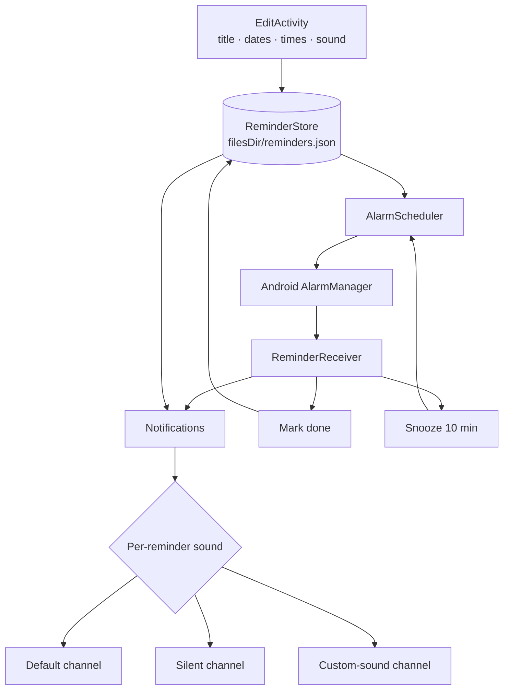

<div align="center">

<h1>ToDo</h1>

<p><strong>A precise, quiet, battery-friendly reminder app for Android.</strong></p>

<p>Typed 12-hour times &nbsp;·&nbsp; Shamsi (Jalali) calendar &nbsp;·&nbsp; Per-reminder sounds &nbsp;·&nbsp; Exact alarms</p>

<p>
  
  
  
  
  
</p>

<p><sub>No account &nbsp;·&nbsp; No cloud &nbsp;·&nbsp; No analytics &nbsp;·&nbsp; No <code>INTERNET</code> permission</sub></p>

</div>

---

ToDo is a reminder app built around a simple idea: **a reminder should be exact, quiet, and entirely yours.** It hands every alert to Android's own alarm clock, so there is no background service, no polling loop, and no battery cost between reminders. Add a task once, give it one or many dates and times on the **Shamsi (Jalali)** calendar, type the time in plain 12-hour format, and choose the sound you want to hear.

<div align="center">

<table>
  <tr>
    <td align="right"><strong>App</strong></td>
    <td><code>ToDo</code> &nbsp;·&nbsp; <code>com.remindly.app</code></td>
  </tr>
  <tr>
    <td align="right"><strong>Version</strong></td>
    <td>1.2 &nbsp;(versionCode 3)</td>
  </tr>
  <tr>
    <td align="right"><strong>Platform</strong></td>
    <td>Android 8.0+ &nbsp;(API 26) &nbsp;·&nbsp; target Android 14 &nbsp;(API 34)</td>
  </tr>
  <tr>
    <td align="right"><strong>Language</strong></td>
    <td>Kotlin 2.0 &nbsp;·&nbsp; Java 17 toolchain</td>
  </tr>
  <tr>
    <td align="right"><strong>Interface</strong></td>
    <td>Views + Material 3 &nbsp;·&nbsp; no Compose runtime</td>
  </tr>
  <tr>
    <td align="right"><strong>Storage</strong></td>
    <td>One local JSON file &nbsp;·&nbsp; no database service</td>
  </tr>
  <tr>
    <td align="right"><strong>Network</strong></td>
    <td>None</td>
  </tr>
  <tr>
    <td align="right"><strong>License</strong></td>
    <td>Proprietary &nbsp;·&nbsp; all rights reserved</td>
  </tr>
</table>

</div>

## Contents

- [Features](#features)
- [How it works](#how-it-works)
- [Typed time](#typed-time)
- [Sounds and channels](#sounds-and-channels)
- [Shamsi calendar](#shamsi-calendar)
- [Reliability and battery](#reliability-and-battery)
- [Install](#install)
- [Build from source](#build-from-source)
- [Project structure](#project-structure)
- [Permissions](#permissions)
- [Privacy and data](#privacy-and-data)
- [Compatibility and verification](#compatibility-and-verification)
- [FAQ](#faq)
- [License](#license)

---

## Features

### Scheduling that stays out of the way

| | |
|:---|:---|
| **Multiple dates and times per task** | Add as many occurrences as you need. Each one is a separate alert, so a single task can cover several days, several times, or both. |
| **Starts on today** | Every new “Add date & time” dialog opens on **today's Shamsi date** — no scrolling back from a default in the past. |
| **Next-first ordering** | The list is sorted by the nearest pending occurrence. Overdue work rises to the top; completed tasks move to a separate **Done** section. |
| **Mark done or snooze** | Tap the circle to complete the next occurrence, or use the notification actions to mark it done or snooze for 10 minutes. |
| **Explicit, not implicit** | There are no hidden recurrence rules. Every alert is a date and a time you can see, edit, or remove. |
| **Full editing** | Reopen a task to change its title, dates, times, or sound. Deleting a task cancels its pending alarms immediately. |

### Sound, on your terms

- **Per-reminder notification sound.** Choose the **system default**, **Silent**, or any notification sound from Android's system ringtone picker.
- **The label always tells you what will play.** The editor shows `Default notification sound`, `Silent`, or the real ringtone title, such as `Antimony`.
- **Correct on modern Android.** Notification channel sounds are immutable once created, so each distinct sound gets its own channel. Changing a reminder's sound therefore changes what you actually hear.
- **High-importance alerts.** Reminders arrive as heads-up notifications with vibration, the scheduled time, **Mark done**, and **Snooze 10 min**.

### Built for the Shamsi calendar

- **Jalali dates everywhere** — list, editor, notifications, and the date picker.
- **Saturday-first weeks** and Persian month names in English transliteration (`Farvardin` … `Esfand`).
- **Month arrows and a year jump** for moving quickly across years.
- **Leap years handled** with the standard Borkowski algorithm, checked against published Nowruz dates.
- **Persian/Farsi titles** render right-to-left, while interface labels stay English and numbers stay Latin.

### Engineered for reliability

- **Android's own alarm clock.** `AlarmManager` delivers each occurrence; the app process wakes only for that moment.
- **Re-armed automatically** after a reboot, an app update, a clock change, or a granted exact-alarm permission.
- **Missed reminders summarised.** If reminders pass while the phone is off, one summary notification appears on the next boot.
- **No services, no jobs, no wakelocks.** Nothing runs between reminders.

### What ToDo deliberately does not do

| Not included | Why |
|:---|:---|
| Accounts or sign-in | Your tasks are local; there is nothing to log in to. |
| Cloud sync | No server, no network permission, no silent uploads. |
| Ads or analytics | Nothing to track, nothing to sell. |
| Background polling | Android alarms are cheaper and more precise. |
| Hidden recurrence | Every alert is an explicit date and time. |

---

## How it works



1. **You save a task.** The editor writes the title, occurrences, and chosen sound to a single JSON file with an atomic replace.
2. **The scheduler arms exact alarms.** Each pending occurrence becomes a `PendingIntent` registered with `AlarmManager` — no service stays alive.
3. **Android wakes the receiver.** At the scheduled moment, `ReminderReceiver` loads the task and occurrence that fired.
4. **The right channel plays the right sound.** The notification is posted on the channel that matches the reminder's sound choice.
5. **Actions loop back.** Marking done persists the change and cancels the alarm; snoozing queues a new alarm ten minutes out.

The result is a full reminder lifecycle with **zero resident processes** and no dependency on a push service.

---

## Typed time

There is no clock dial. Times are typed as **`hh:mm AM/PM`**, which is faster on a keyboard and unambiguous on a phone.

| You type | Stored as | Notes |
|:---|:---|:---|
| `9:30 PM` | 21:30 | Single-digit hours are fine. |
| `09:30PM` | 21:30 | Spaces before AM/PM are optional. |
| `09:30 p.m.` | 21:30 | Dots and case are accepted. |
| `12:00 AM` | 00:00 | Midnight. |
| `12:00 PM` | 12:00 | Noon. |
| `00:00 AM` | 00:00 | Midnight in 00-hour notation. |
| `25:00 PM` | — | Rejected with an inline format hint. |

Validation runs before the dialog closes: the hour must be **0–12**, the minute **0–59**, and an **AM/PM** suffix is required. The same input dialog is used when adding and changing times, and the chips display the normalised value (`09:30 PM`).

---

## Sounds and channels

Android 8.0 and later fix a channel's sound when the channel is created. To let every reminder choose independently, ToDo maps each sound choice to its own channel:

| Choice in the editor | What plays | Channel |
|:---|:---|:---|
| **Default notification sound** | The system default notification sound | `reminders_v1` |
| **Silent** | Nothing — the alert still appears and vibrates | `reminders_silent` |
| **Choose a sound…** | The ringtone picked in Android's system sound picker | `reminders_sound_<hash>` |

The picker is the platform's own **ringtone picker** (`RingtoneManager`), so any notification sound available to Android can be selected. Choosing **None** in the picker maps to **Silent**. Channels are created on demand and are also recreated at startup for existing reminders, so saved choices keep working across reboots and updates.

A note on notification settings: if a user later changes a channel's sound in Android Settings, the system owns that choice. ToDo never overwrites user modifications.

---

## Shamsi calendar

Dates use the **Shamsi (Jalali / Solar Hijri)** calendar, the official calendar of Iran:

- Farvardin–Esfand, with 31-day months in the first half and 30-day months in the second.
- Esfand has **30 days in leap years** such as 1403.
- Weeks start on **Saturday**.
- Month names appear in English transliteration (`Aban`) so the rest of the interface stays English.

Reminders are stored as **epoch timestamps**, so the calendar affects labels only. Alarm timing, time zones, and daylight saving are handled by Android. Conversions use the standard Borkowski algorithm and are checked against published Nowruz dates:

| Shamsi date | Gregorian date |
|:---|:---|
| 1 Farvardin 1404 | 21 March 2025 |
| 1 Farvardin 1405 | 21 March 2026 |
| 30 Esfand 1403 | 20 March 2025 |

---

## Reliability and battery

**The app does not run in the background.** There is no foreground service, no background service, no `JobScheduler` job, and no wakelock. Between reminders the process is not running.

- **Exact delivery.** `SCHEDULE_EXACT_ALARM` and `USE_EXACT_ALARM` keep alerts on time. On Android 13+ `USE_EXACT_ALARM` is granted automatically; on Android 12 the system grants `SCHEDULE_EXACT_ALARM` at install.
- **Graceful fallback.** If exact alarms are turned off, the app shows a banner and still delivers with the best alarm path the system permits.
- **Reboot-safe.** `BootReceiver` re-arms pending alarms after a reboot, app update, or clock change.
- **Missed summary.** Alerts that would have fired while the phone was powered off are collected into one “You missed …” notification on the next boot.
- **Self-check.** The Reliability screen shows notification, exact-alarm, and battery-optimisation status, and can send a test reminder in 10 seconds.

### One-time setup on Samsung

Open **ToDo → alarm icon (top right) → Reliability** and confirm:

1. **Notifications** are allowed.
2. **Exact alarms** are allowed under “Alarms & reminders”.
3. **Battery optimization** is set to **Unrestricted**.
4. Under **Samsung battery tips**, keep ToDo out of *Sleeping apps* / *Deep sleeping apps*, turn off *Put unused apps to sleep*, and use *Keep open* in Recents.

These steps matter on Galaxy phones, which can otherwise silence alarms for apps they consider unused.

---

## Install

### From a built APK

```bash
adb install -r ToDo-v1.2.apk
```

Or copy the APK to the phone, open it, and allow installing from that source when prompted. On first launch, grant the notification permission.

The release APK is signed with a private local key (`app/keystore/local.jks`), which is intentionally **not** committed. Keep the same key if you want future builds to install as updates.

### First run

1. Grant notifications when asked.
2. Open the **Reliability** screen from the alarm icon.
3. Confirm exact alarms and battery status.
4. Tap **New reminder**, type a title, add a date and time, choose a sound, and save.

A clean install contains **no sample or demo reminders**.

---

## Build from source

**Requirements**

| Tool | Version |
|:---|:---|
| JDK | 17 |
| Android SDK | Platform 34 + Build-Tools 34 |
| Gradle | Wrapper included (8.11.1) |
| Kotlin | 2.0.21 (via Gradle plugin) |

```bash
git clone https://github.com/farokh-ra/ToDo.git
cd ToDo

# Debug build
./gradlew assembleDebug

# Signed, minified release build
./gradlew assembleRelease
```

On Windows, use `gradlew.bat` instead of `./gradlew`.

**Outputs**

| Build | Path |
|:---|:---|
| Debug | `app/build/outputs/apk/debug/app-debug.apk` |
| Release | `app/build/outputs/apk/release/app-release.apk` |

Set `local.properties` with `sdk.dir=...`, or export `ANDROID_HOME`, before running Gradle from the command line. Release signing expects a keystore at `app/keystore/local.jks`; provide your own key there or update the `signingConfigs` block for your environment.

---

## Project structure

```text
ToDo/
├── app/
│   ├── src/main/java/com/remindly/app/
│   │   ├── App.kt                     process init: storage, channels, reschedule
│   │   ├── data/
│   │   │   ├── Models.kt              Reminder + Occurrence (+ sound choice)
│   │   │   └── ReminderStore.kt       atomic JSON persistence
│   │   ├── alarm/
│   │   │   ├── AlarmScheduler.kt      exact alarms, fallback, snooze, test
│   │   │   ├── ReminderReceiver.kt    alarm delivery, Done / Snooze actions
│   │   │   └── BootReceiver.kt        re-arm after reboot/update/time change
│   │   ├── notify/
│   │   │   └── Notifications.kt       per-sound channels, alerts, missed summary
│   │   ├── ui/
│   │   │   ├── MainActivity.kt        sorted list, sections, banners, menus
│   │   │   ├── EditActivity.kt        title, typed times, sound, save
│   │   │   ├── JalaliDatePicker.kt    Shamsi calendar dialog
│   │   │   └── ReliabilityActivity.kt permissions/status and test alarm
│   │   └── util/
│   │       ├── Jalali.kt              conversions, leap years, month names
│   │       └── TimeFmt.kt             dates, times, countdowns
│   ├── src/main/res/                  layouts, themes, strings, icons
│   └── build.gradle.kts
├── gradle/wrapper/
├── build.gradle.kts
├── settings.gradle.kts
└── README.md
```

**Design choices**

- **Views, not Compose.** The app targets a single activity stack with classic views and Material 3, keeping the release APK small (about 1.5 MB) and startup straightforward.
- **One JSON file.** `reminders.json` is a few kilobytes; every write is a small atomic replace instead of a database transaction.
- **No dependency injection framework.** A small object graph keeps the APK lean and the behaviour obvious.

---

## Permissions

| Permission | Purpose | When it is requested |
|:---|:---|:---|
| `POST_NOTIFICATIONS` | Show reminder alerts | Runtime prompt on Android 13+ |
| `SCHEDULE_EXACT_ALARM` | Exact delivery on Android 12 | Granted by the system at install |
| `USE_EXACT_ALARM` | Exact delivery on Android 13+ | Auto-granted for alarm/reminder apps |
| `RECEIVE_BOOT_COMPLETED` | Re-arm pending alarms after reboot | Declared only; no prompt |
| `VIBRATE` | Notification vibration | Declared only; no prompt |
| `REQUEST_IGNORE_BATTERY_OPTIMIZATIONS` | Optional reliability setup | User action from the Reliability screen |

The app declares **no `INTERNET` permission** and has no network code.

---

## Privacy and data

ToDo stores everything on the device:

```json
{
  "version": 1,
  "reminders": [
    {
      "id": "…",
      "title": "…",
      "createdAt": 1794671717010,
      "soundUri": "content://media/internal/audio/media/179?title=Antimony&canonical=1",
      "occurrences": [
        { "id": "…", "at": 1794671880000, "done": false, "notified": false }
      ]
    }
  ]
}
```

- **Location:** `filesDir/reminders.json` inside the app's private storage.
- **No account, server, telemetry, or crash reporting.**
- **Uninstalling the app removes its local data.**
- **Device backup:** if Android backup is enabled, the system may include the app's data according to the platform's rules.
- **Ringtone URIs** are references to sounds already on the device; the app does not copy or upload audio.

---

## Compatibility and verification

| Android version | Status |
|:---|:---|
| 8.0–11 (API 26–30) | Supported by the manifest and minSdk; exact alarms need no special permission. |
| 12 (API 31–32) | Supported; `SCHEDULE_EXACT_ALARM` granted at install. |
| 13–15 (API 33–35) | Supported; `USE_EXACT_ALARM` grants exact delivery, notification permission is requested at runtime. |

**Tested on Android 15** (Galaxy A-series emulator, `SM-A156E`):

- Created and saved tasks with several times in one date and verified the occurrences in storage.
- Verified next-first sorting, an overdue card on top, Persian right-to-left titles, and the Shamsi picker.
- Opened the picker on **Aban 1405** with a Saturday-first week; **25 Aban** stored 16 November 2026, 9:00 PM Tehran time, and both the card and “Next” line showed **Mon 25 Aban**.
- Rolled the month arrows from Aban 1405 into **Farvardin 1406** (31 days, 1 Farvardin on Sunday), matching the published Nowruz date of 21 March 2027.
- Checked conversions against published Nowruz dates: 1 Farvardin 1404 = 21 March 2025, 1 Farvardin 1405 = 21 March 2026, and 30 Esfand 1403 = 20 March 2025.
- Measured exact delivery at **54 ms after the scheduled second**.
- Confirmed the notification shows the title, scheduled time, **Mark done**, and **Snooze 10 min**; snooze clears it and queues an alarm ten minutes out.
- Marked a task done, confirmed it persisted immediately, and watched the card move to **Done**.
- Re-armed alarms after reboot and posted a missed-reminder summary. The test image blocks the system boot broadcast for restricted apps, so the receiver was exercised with an explicit boot intent — the same behaviour the Reliability screen addresses on Samsung.
- Opened existing tasks with their title and dates loaded, changed the schedule with the Shamsi picker and a typed time.
- Typed `09:30 PM` (saved and shown as 9:30 PM); rejected `25:00 PM` with a format hint; confirmed new dates default to **today**.
- Fired a reminder set to the **Antimony** ringtone on its own channel, and a second reminder set to **Silent** on the silent channel with no sound.
- Confirmed a clean install contains no sample reminders and that no services or JobScheduler jobs exist between reminders.

---

## FAQ

<details>
<summary><strong>Does ToDo run in the background?</strong></summary>
<p>No. Android's <code>AlarmManager</code> holds each pending alert. The app process wakes when a reminder fires and is not resident between reminders.</p>
</details>

<details>
<summary><strong>Will a reminder fire if my phone is off?</strong></summary>
<p>No — the hardware cannot wake an app while powered down. On the next boot, ToDo posts one summary notification for reminders that were missed.</p>
</details>

<details>
<summary><strong>Why does each sound need its own notification channel?</strong></summary>
<p>Android fixes a channel's sound when the channel is created. To support a different sound per reminder, ToDo creates a channel per distinct sound instead of changing one shared channel.</p>
</details>

<details>
<summary><strong>Can I change a reminder's sound after saving it?</strong></summary>
<p>Yes. Reopen the task, tap the Sound row, and choose Default, Silent, or a new ringtone. The next alert uses the new channel.</p>
</details>

<details>
<summary><strong>Does it sync between devices?</strong></summary>
<p>No. Storage is local and the app has no network permission. Moving data between devices requires a manual backup of the app's data.</p>
</details>

<details>
<summary><strong>Why does the interface use English while dates are Shamsi?</strong></summary>
<p>The UI labels are English and month names are transliterated, while the calendar itself is Jalali. Persian text in task titles is fully supported and renders right-to-left.</p>
</details>

<details>
<summary><strong>Is ToDo open source?</strong></summary>
<p>No. ToDo is proprietary software. Installation and personal use of official releases are permitted under the license; copying, modification, redistribution, and commercial use require prior written permission.</p>
</details>

---

## License

> **ToDo is proprietary software. It is not open source.**
>
> You may install and use official releases for your own tasks under the terms of the license. You may not copy, modify, reuse, redistribute, or commercially exploit the software or its source code without prior written permission from the licensor. All rights not expressly granted are reserved.

Read the full **[Proprietary Software License](LICENSE.md)** for definitions, permitted use, restrictions, termination, and warranty terms.

<div align="center">

<sub>© 2026 Farokh RashidAhmadi · All rights reserved</sub>

<sub>Built with Kotlin, Material 3, and Android's alarm clock.</sub>

</div>
