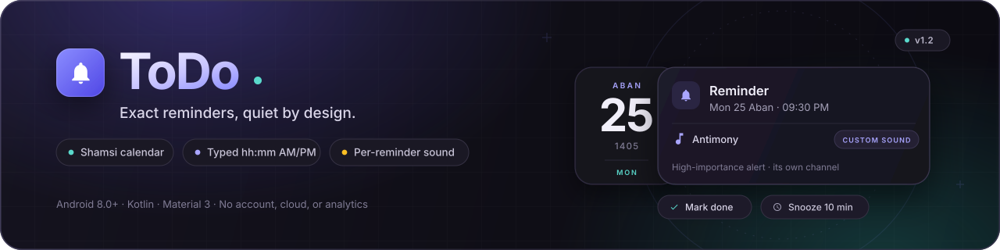
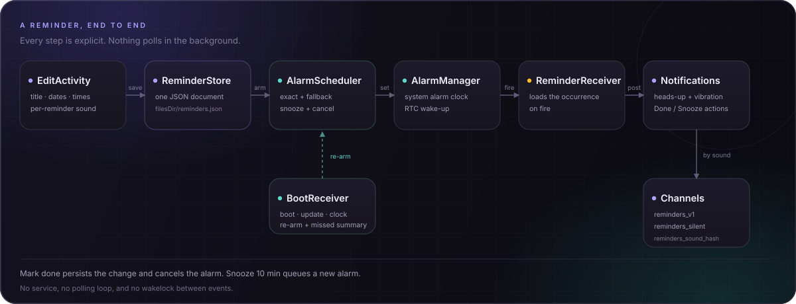

<div align="center">



<br>

<p>
  
  
  
  
  
</p>

<p><sub>No account &nbsp;·&nbsp; No cloud &nbsp;·&nbsp; No analytics &nbsp;·&nbsp; No <code>INTERNET</code> permission</sub></p>

</div>

ToDo is a reminder app built around a simple idea: **a reminder should be exact, quiet, and entirely yours.** It gives every alert to Android's own alarm clock, so no background service runs between reminders. Add a task once, attach one or many dates and times on the **Shamsi (Jalali)** calendar, type times in plain 12-hour format, and choose the sound each reminder should make.

<div align="center">

<table>
  <tr>
    <td align="right"><strong>App</strong></td>
    <td><code>ToDo</code> &nbsp;·&nbsp; <code>com.remindly.app</code></td>
  </tr>
  <tr>
    <td align="right"><strong>Version</strong></td>
    <td>1.2 &nbsp;(versionCode 3)</td>
  </tr>
  <tr>
    <td align="right"><strong>Platform</strong></td>
    <td>Android 8.0+ &nbsp;(API 26) &nbsp;·&nbsp; target Android 14 &nbsp;(API 34)</td>
  </tr>
  <tr>
    <td align="right"><strong>Language</strong></td>
    <td>Kotlin 2.0 &nbsp;·&nbsp; Java 17 toolchain</td>
  </tr>
  <tr>
    <td align="right"><strong>Interface</strong></td>
    <td>Views + Material 3 &nbsp;·&nbsp; no Compose runtime</td>
  </tr>
  <tr>
    <td align="right"><strong>Storage</strong></td>
    <td>One local JSON file &nbsp;·&nbsp; no database service</td>
  </tr>
  <tr>
    <td align="right"><strong>Network</strong></td>
    <td>None</td>
  </tr>
  <tr>
    <td align="right"><strong>License</strong></td>
    <td>Proprietary &nbsp;·&nbsp; all rights reserved</td>
  </tr>
</table>

</div>

## Contents

- **Product:** [Features](#features) · [Typed time](#typed-time) · [Sounds and channels](#sounds-and-channels) · [Shamsi calendar](#shamsi-calendar) · [Reliability and battery](#reliability-and-battery)
- **Engineering:** [How it works](#how-it-works) · [Design notes](#design-notes) · [Project structure](#project-structure) · [Build from source](#build-from-source)
- **Using ToDo:** [Install](#install) · [Permissions](#permissions) · [Privacy and data](#privacy-and-data) · [Compatibility and verification](#compatibility-and-verification) · [FAQ](#faq)
- **Project:** [Release notes](#release-notes) · [Security](#security) · [Contributing](#contributing) · [Acknowledgements](#acknowledgements) · [License](#license)

---

## Features

### Scheduling that stays out of the way

| | |
|:---|:---|
| **Multiple dates and times per task** | Add as many occurrences as you need. Each one is a separate alert, so a single task can cover several days, several times, or both. |
| **Starts on today** | Every new “Add date & time” dialog opens on **today's Shamsi date**, and the first time chip defaults to the next hour (or 23:59 late at night). |
| **Next-first ordering** | The list is sorted by the nearest pending occurrence. Overdue work rises to the top; completed tasks move to a separate **Done** section. |
| **Mark done or snooze** | Tap the circle to complete the next occurrence, or use the notification actions to mark it done or snooze for 10 minutes. |
| **Explicit, not implicit** | There are no hidden recurrence rules and no repeat presets. Every alert is a date and a time you can see, edit, or remove. |
| **Full editing** | Reopen a task to change its title, dates, times, or sound. Deleting a task cancels its pending alarms immediately. |

### Sound, on your terms

- **Per-reminder notification sound.** Choose the **system default**, **Silent**, or any notification sound from Android's system ringtone picker.
- **The label always tells you what will play.** The editor shows `Default notification sound`, `Silent`, or the real ringtone title, such as `Antimony`.
- **Correct on modern Android.** Notification channel sounds are immutable once created, so each distinct sound gets its own channel. Changing a reminder's sound therefore changes what you actually hear.
- **High-importance alerts.** Reminders arrive as heads-up notifications with vibration, the scheduled time, **Mark done**, and **Snooze 10 min**.

### Built for the Shamsi calendar

- **Jalali dates everywhere** — list, editor, notifications, and the date picker.
- **Saturday-first weeks** and Persian month names in English transliteration (`Farvardin` … `Esfand`).
- **Month arrows and a year jump** for moving quickly across years.
- **Leap years handled** with the standard Borkowski algorithm, checked against published Nowruz dates.
- **Persian/Farsi titles** render right-to-left, while interface labels stay English and numbers stay Latin.

### Engineered for reliability

- **Android's own alarm clock.** `AlarmManager` delivers each occurrence; the app wakes only for that moment.
- **Re-armed automatically** after a reboot, an app update, a clock change, or a granted exact-alarm permission.
- **Missed reminders summarised.** If reminders pass while the phone is off, one summary notification appears on the next boot.
- **No services, no jobs, no wakelocks.** No app code runs between reminders.

### What ToDo deliberately does not do

| Not included | Why |
|:---|:---|
| Accounts or sign-in | Your tasks are local; there is nothing to log in to. |
| Cloud sync | No server, no network permission, no silent uploads. |
| Ads or analytics | Nothing to track, nothing to sell. |
| Background polling | Android alarms are cheaper and more precise. |
| Hidden recurrence | Every alert is an explicit date and time. |
| Sample reminders | A clean install starts empty, with nothing to delete first. |

---

## How it works

<div align="center">



</div>

1. **You save a task.** The editor writes the title, occurrences, and chosen sound to a single JSON file with a temp-file replace.
2. **The scheduler arms exact alarms.** Each pending occurrence becomes a `PendingIntent` registered with `AlarmManager` — no service stays alive.
3. **Android wakes the receiver.** At the scheduled moment, `ReminderReceiver` loads the task and occurrence that fired.
4. **The right channel plays the right sound.** The notification is posted on the channel that matches the reminder's sound choice.
5. **Actions loop back.** Marking done persists the change and cancels the alarm; snoozing queues a new alarm ten minutes out.

The result is a complete reminder lifecycle with **no resident components** and no dependency on a push service.

---

## Design notes

ToDo is intentionally small: one application process, one in-memory list, and one file on disk. There is no database, no dependency-injection framework, no background scheduler, and no networking. The interesting decisions are therefore about **time, storage, and Android's delivery guarantees** rather than about layers of abstraction.

### Components

| Component | Responsibility |
|:---|:---|
| `App` | Initialises storage, notification channels, and alarm state at process start. |
| `ReminderStore` | Loads and saves the JSON document; exposes a synchronised, observable in-memory list. |
| `AlarmScheduler` | Turns pending occurrences into exact alarms, handles snooze, cancellation, and fallbacks. |
| `ReminderReceiver` | Handles a fired alarm plus the **Done** and **Snooze** notification actions. |
| `BootReceiver` | Re-arms alarms after boot, app update, clock change, or an exact-alarm permission change. |
| `Notifications` | Creates per-sound channels and posts reminders, test alerts, and the missed-reminder summary. |
| `MainActivity` | Builds the next-first list, the Done section, banners, and item menus. |
| `EditActivity` | Edits the title, typed times, occurrences, and sound; saves and deletes tasks. |
| `ReliabilityActivity` | Reports notification, exact-alarm, and battery status and can fire a test alert. |
| `Jalali` / `TimeFmt` | Converts between Jalali and Gregorian dates and formats every label. |

### Storage and data model

Everything lives in `filesDir/reminders.json`. Timestamps are **UTC epoch milliseconds**, so the Jalali calendar is a presentation layer only: changing the calendar, locale, or month labels never changes the instant an alarm fires.

```json
{
  "version": 1,
  "reminders": [
    {
      "id": "9c1f0a52-6a58-4f0e-95ad-0f8a5d4f2e11",
      "title": "Call the dentist",
      "createdAt": 1794671717010,
      "soundUri": "content://media/internal/audio/media/179?title=Antimony&canonical=1",
      "occurrences": [
        { "id": "7b2e…", "at": 1794671880000, "done": false, "notified": false }
      ]
    }
  ]
}
```

| Field | Type | Meaning |
|:---|:---|:---|
| `version` | number | Schema version. Currently `1`. |
| `reminders[].id` | string | Stable UUID. Editing a task keeps its ID, so its alarms can be replaced cleanly. |
| `reminders[].title` | string | Task title. Persian and English text are both stored as plain UTF-8. |
| `reminders[].createdAt` | number | Creation time in epoch milliseconds. |
| `reminders[].soundUri` | string | `""` for the system default, `"silent"` for no sound, otherwise a ringtone `content://` URI. |
| `occurrences[].id` | string | UUID used as the alarm request code and notification ID. |
| `occurrences[].at` | number | Scheduled instant in epoch milliseconds. |
| `occurrences[].done` | boolean | Completed occurrences are not scheduled and are skipped when a stale alarm arrives. |
| `occurrences[].notified` | boolean | Idempotency flag: prevents posting the same occurrence twice. Reset when an occurrence is marked undone or its time is changed. |

**Write path.** A full document is serialised to `reminders.json.tmp`, the previous file is removed, and the temp file is renamed into place. If the rename fails, the app falls back to a direct write. Writes are guarded by `@Synchronized`, and the main list subscribes to an in-process listener so it updates immediately after a change.

**Load path.** Malformed JSON is logged and the store starts empty rather than crashing. Unknown fields are ignored, occurrences without a positive timestamp are skipped, and missing IDs are replaced with fresh UUIDs on load.

### Scheduling and edge cases

- **One alarm per pending occurrence.** `syncAll()` collects every undone occurrence in the future, sorts by time, and arms the nearest **400** — a ceiling well above realistic manual use.
- **Distinct request codes.** A normal alarm uses the occurrence ID hash; a snooze uses a prefixed hash, so snoozing does not overwrite the original pending intent.
- **Permission-aware delivery.** When exact alarms are available, ToDo uses `setExactAndAllowWhileIdle()`. When they are not, it tries `setAlarmClock()`. If the system rejects that too, it falls back to `setAndAllowWhileIdle()`. Every path is wrapped in `SecurityException` handling.
- **Past occurrences are kept, not silently dropped.** They appear as passed/overdue in the editor and list, but are never scheduled. Mark them done or remove them.
- **Done means cancelled.** Marking an occurrence done, marking all done, or deleting a task cancels the matching alarms and visible notifications.
- **Duplicate delivery is harmless.** A fired occurrence with `notified = true` is ignored unless the wake-up is an explicit snooze.
- **Force-stop is a hard stop.** Android cancels alarms for a force-stopped app. Opening ToDo again calls `syncAll()` and rearms the future occurrences.
- **Phone powered off.** No app can fire while the device is off. On boot, the missed summary covers the last seven days of undone, unnotified occurrences, lists the six most recent, and reports the remainder as “+N more”.
- **State is recovered, not guessed.** Reboots, package replacements, clock changes, and exact-alarm permission changes all route through `BootReceiver`, which re-reads storage and rearms — it does not trust data carried in the broadcast.

### Trade-offs we accepted

| Decision | Why | Cost |
|:---|:---|:---|
| Views + Material 3 instead of Compose | Fast cold start and a small release APK (about 1.4 MB). | More XML and manual view wiring. |
| One JSON file instead of Room | The whole data set is a few kilobytes; no schema migration or database service is needed. | No indexed queries or partial updates. |
| No dependency-injection framework | The object graph is small enough to read in one sitting. | Manual wiring as the app grows. |
| Local-only storage | Privacy is a product feature, not a setting. | No sync or cross-device restore. |
| Keeping `com.remindly.app` | The application ID defines app identity; changing it would create a second app and break updates. | The package name no longer matches the display name. |
| No recurring rules | Explicit occurrences are easier to inspect, edit, and reason about. | Repetitive schedules take a few extra taps. |

---

## Typed time

There is no clock dial. Times are typed as **`hh:mm AM/PM`**, which is faster on a keyboard and unambiguous on a phone.

| You type | Stored as | Notes |
|:---|:---|:---|
| `9:30 PM` | 21:30 | Single-digit hours are fine. |
| `09:30PM` | 21:30 | Spaces before AM/PM are optional. |
| `09:30 p.m.` | 21:30 | Dots and case are accepted. |
| `12:00 AM` | 00:00 | Midnight. |
| `12:00 PM` | 12:00 | Noon. |
| `00:00 AM` | 00:00 | Midnight in 00-hour notation. |
| `25:00 PM` | — | Rejected with an inline format hint. |

Validation runs before the dialog closes: the hour must be **0–12**, the minute **0–59**, and an **AM/PM** suffix is required. One or two digits are accepted for the hour and minute. The same input dialog is used when adding and changing times, and the chips display the normalised zero-padded value (`09:30 PM`).

---

## Sounds and channels

Android 8.0 and later fix a channel's sound when the channel is created. To let every reminder choose independently, ToDo maps each sound choice to its own channel:

| Choice in the editor | What plays | Channel |
|:---|:---|:---|
| **Default notification sound** | The system default notification sound | `reminders_v1` |
| **Silent** | Nothing — the alert still appears and vibrates | `reminders_silent` |
| **Choose a sound…** | The ringtone picked in Android's system sound picker | `reminders_sound_<hash>` |

The picker is the platform's own **ringtone picker** (`RingtoneManager`), so any notification sound available to Android can be selected. Picking the system default maps back to **Default**; picking **None** maps to **Silent**. Channels are created on demand and are also recreated at startup for existing reminders, so saved choices keep working across reboots and updates.

Each channel is high-importance, vibrates, shows a badge, and is named after the sound (`ToDo · Antimony`) so it is recognisable in Android's notification settings. If a channel already exists, ToDo leaves it alone — **the user's own channel changes are never overwritten**. If a custom channel cannot be created, the alert falls back to the default channel rather than being lost.

---

## Shamsi calendar

Dates use the **Shamsi (Jalali / Solar Hijri)** calendar, the official calendar of Iran:

- Farvardin–Esfand, with 31-day months in the first half and 30-day months in the second.
- Esfand has **30 days in leap years** such as 1403.
- Weeks start on **Saturday**.
- Month names appear in English transliteration (`Aban`) so the rest of the interface stays English.

Reminders are stored as **epoch timestamps**, so the calendar affects labels only. Alarm timing, time zones, and daylight saving are handled by Android. Conversions use the Borkowski break-year algorithm (valid for Jalali years **1178–3177**) and are checked against published Nowruz dates:

| Shamsi date | Gregorian date |
|:---|:---|
| 1 Farvardin 1404 | 21 March 2025 |
| 1 Farvardin 1405 | 21 March 2026 |
| 30 Esfand 1403 | 20 March 2025 |

---

## Reliability and battery

**No app component runs in the background.** There is no foreground service, no background service, no `JobScheduler` job, and no wakelock. Android may keep a cached process after an alert, but nothing executes and nothing holds the device awake between reminders.

- **Exact delivery.** `USE_EXACT_ALARM` covers Android 13+ and `SCHEDULE_EXACT_ALARM` covers Android 12's special access. When exact alarms are available, `setExactAndAllowWhileIdle()` delivers at the scheduled minute, even in Doze.
- **Graceful fallback.** If exact alarms are turned off, the app shows a banner and still tries the system alarm-clock path, then an inexact alarm.
- **Reboot-safe.** `BootReceiver` re-arms pending alarms after a reboot, app update, or clock change.
- **Missed summary.** Alerts that would have fired while the phone was powered off are collected into one “You missed …” notification on the next boot.
- **Self-check.** The Reliability screen shows notification, exact-alarm, and battery-optimisation status, and can send a test reminder in 10 seconds.

### When things go wrong

| Condition | What ToDo does |
|:---|:---|
| Exact alarms revoked | Shows a banner, falls back to the alarm-clock path, then an inexact alarm if needed. |
| Notifications blocked | The alarm still fires, but Android suppresses the notification; the Reliability screen reports the block. |
| Phone powered off | Nothing can fire; on boot, a seven-day missed summary is posted. |
| App force-stopped | Android cancels its alarms; opening ToDo rearms all future occurrences. |
| Task deleted while an alarm is armed | Deletion cancels the pending intent; a stale alarm that still arrives finds no record and returns. |
| Alarm fires twice | The `notified` flag suppresses the duplicate unless it is an explicit snooze. |
| `reminders.json` is unreadable | The error is logged, the app starts with an empty list, and the unreadable file is not overwritten until the next save. |
| A save fails | The error is logged; the in-memory list keeps working, but unsaved changes can be lost if the process dies. |

### One-time setup on Samsung

Open **ToDo → alarm icon (top right) → Reliability** and confirm:

1. **Notifications** are allowed.
2. **Exact alarms** are allowed under “Alarms and reminders”.
3. **Battery optimization** is set to **Unrestricted**.
4. Under **Samsung battery tips**, keep ToDo out of *Sleeping apps* / *Deep sleeping apps*, turn off *Put unused apps to sleep*, and use *Keep open* in Recents.

These steps matter on Galaxy phones, which can otherwise silence alarms for apps they consider unused.

---

## Install

ToDo is distributed as source; the repository does not commit APK binaries. Build a debug APK and install it in one pass:

```bash
git clone https://github.com/farokh-ra/ToDo.git
cd ToDo
./gradlew assembleDebug
adb install -r app/build/outputs/apk/debug/app-debug.apk
```

On Windows, use `gradlew.bat`. A debug build is signed by the local debug key and needs no signing setup. For a signed, minified release, see [Build from source](#build-from-source).

### First run

1. Grant notifications when asked. On Android 13+ the prompt appears once on first launch.
2. Open the **Reliability** screen from the alarm icon.
3. Confirm exact alarms and battery status.
4. Tap **New reminder**, type a title, add a date and time, choose a sound, and save.

A clean install contains **no sample or demo reminders**.

---

## Build from source

**Requirements**

| Tool | Version |
|:---|:---|
| JDK | 17 |
| Android SDK | Platform 34 + Build-Tools 34 |
| Gradle | Wrapper included (8.11.1) |
| Kotlin | 2.0.21 (via Gradle plugin) |

```bash
git clone https://github.com/farokh-ra/ToDo.git
cd ToDo

# Debug build
./gradlew assembleDebug

# Signed, minified release build
./gradlew assembleRelease
```

On Windows, use `gradlew.bat` instead of `./gradlew`.

**Outputs**

| Build | Path | Notes |
|:---|:---|:---|
| Debug | `app/build/outputs/apk/debug/app-debug.apk` | Signed with the debug key; installable immediately. |
| Release | `app/build/outputs/apk/release/app-release.apk` | Minified with R8, resources shrunk, signed with the configured local key. |

Set `local.properties` with `sdk.dir=...`, or export `ANDROID_HOME`, before running Gradle from the command line.

**Release signing.** `app/build.gradle.kts` points release signing at `app/keystore/local.jks`. That key is intentionally **not** committed, so a fresh clone must supply its own key at that path (and update the `signingConfigs` block if the alias or passwords differ) before `assembleRelease` can succeed. Never commit a keystore or its passwords. Keep the same key for future releases if you want them to install as updates over an earlier build.

---

## Project structure

```text
ToDo/
├── app/
│   ├── src/main/java/com/remindly/app/
│   │   ├── App.kt                     process init: storage, channels, reschedule
│   │   ├── data/
│   │   │   ├── Models.kt              Reminder + Occurrence (+ sound choice)
│   │   │   └── ReminderStore.kt       JSON persistence, load/save, listeners
│   │   ├── alarm/
│   │   │   ├── AlarmScheduler.kt      exact alarms, fallback, snooze, test
│   │   │   ├── ReminderReceiver.kt    alarm delivery, Done / Snooze actions
│   │   │   └── BootReceiver.kt        re-arm after reboot/update/time change
│   │   ├── notify/
│   │   │   └── Notifications.kt       per-sound channels, alerts, missed summary
│   │   ├── ui/
│   │   │   ├── MainActivity.kt        sorted list, sections, banners, menus
│   │   │   ├── EditActivity.kt        title, typed times, sound, save
│   │   │   ├── JalaliDatePicker.kt    Shamsi calendar dialog
│   │   │   ├── ReliabilityActivity.kt permissions/status and test alarm
│   │   │   └── ReminderAdapter.kt     list rows and Done styling
│   │   └── util/
│   │       ├── Jalali.kt              conversions, leap years, month names
│   │       └── TimeFmt.kt             dates, times, countdowns
│   ├── src/main/res/                  layouts, themes, strings, icons
│   └── build.gradle.kts
├── docs/assets/banner.svg             README hero artwork
├── docs/assets/architecture.svg       reminder lifecycle diagram
├── gradle/wrapper/
├── build.gradle.kts
├── settings.gradle.kts
├── LICENSE.md
└── README.md
```

---

## Permissions

| Permission | Purpose | When it is requested |
|:---|:---|:---|
| `POST_NOTIFICATIONS` | Show reminder alerts | Runtime prompt once on Android 13+; can be changed later in Settings |
| `SCHEDULE_EXACT_ALARM` | Exact delivery on Android 12 | Special app access; declared in the manifest |
| `USE_EXACT_ALARM` | Exact delivery on Android 13+ | Auto-granted for alarm/reminder apps |
| `RECEIVE_BOOT_COMPLETED` | Re-arm pending alarms after reboot | Declared only; no prompt |
| `VIBRATE` | Notification vibration | Declared only; no prompt |
| `REQUEST_IGNORE_BATTERY_OPTIMIZATIONS` | Optional reliability setup | User action from the Reliability screen |

The app declares **no `INTERNET` permission**, no storage permission, and no location or contacts access. Its data file lives in app-private storage, which needs no permission at all. The merged manifest also contains a signature-level `DYNAMIC_RECEIVER_NOT_EXPORTED_PERMISSION` contributed by AndroidX to protect dynamically registered receivers; it is never requested from users.

---

## Privacy and data

ToDo stores everything on the device:

- **Location:** `filesDir/reminders.json` inside the app's private storage.
- **No account, server, telemetry, or crash reporting.** There is no networking code and no network permission to grant.
- **Uninstalling the app removes its local data.**
- **Device backup:** `allowBackup` is enabled, so the platform's backup settings may include the app's data in a device or cloud backup. ToDo itself never uploads anything.
- **Ringtone URIs** are references to sounds already on the device; the app does not copy or upload audio.
- **At-rest protection** is provided by Android's app sandbox and file-based encryption. ToDo does not add a second layer of encryption; a rooted or compromised device can read app-private files.

---

## Compatibility and verification

| Android version | Status |
|:---|:---|
| 8.0–11 (API 26–30) | Supported by the manifest and `minSdk`; exact alarms need no special permission on these releases. |
| 12 (API 31–32) | Supported; exact alarms use Android's special app access. |
| 13–15 (API 33–35) | Supported; notification permission is requested at runtime and `USE_EXACT_ALARM` grants exact delivery. |
| 16 (API 36) | Manifest-compatible and expected to run; outside the current device test matrix. |

**Verified on Android 15** (Galaxy A-series emulator, `SM-A156E`):

- Created and saved tasks with several times in one date and verified the occurrences in storage.
- Verified next-first sorting, an overdue card on top, Persian right-to-left titles, and the Shamsi picker.
- Opened the picker on **Aban 1405** with a Saturday-first week; **25 Aban** stored 16 November 2026, 9:00 PM Tehran time, and both the card and “Next” line showed **Mon 25 Aban**.
- Rolled the month arrows from Aban 1405 into **Farvardin 1406** (31 days, 1 Farvardin on Sunday), matching the published Nowruz date of 21 March 2027.
- Checked conversions against published Nowruz dates: 1 Farvardin 1404 = 21 March 2025, 1 Farvardin 1405 = 21 March 2026, and 30 Esfand 1403 = 20 March 2025.
- Measured exact delivery at **54 ms after the scheduled second**.
- Confirmed the notification shows the title, scheduled time, **Mark done**, and **Snooze 10 min**; snooze clears it and queues an alarm ten minutes out.
- Marked a task done, confirmed it persisted immediately, and watched the card move to **Done**.
- Re-armed alarms with an explicit boot broadcast and posted a missed-reminder summary. The emulator image blocks system boot broadcasts for restricted apps, so the receiver was invoked directly rather than by a full device reboot.
- Opened existing tasks with their title and dates loaded, changed the schedule with the Shamsi picker and a typed time.
- Typed `09:30 PM` (saved and shown as 9:30 PM); rejected `25:00 PM` with a format hint; confirmed new dates default to **today**.
- Fired a reminder set to the **Antimony** ringtone on its own channel, and a second reminder set to **Silent** on the silent channel with no sound.
- Confirmed a clean install contains no sample reminders and that no services or JobScheduler jobs exist between reminders.

**Build verification for 1.2.** Both `assembleDebug` and `assembleRelease` pass. `aapt` reports label `ToDo`, `versionName 1.2`, `versionCode 3`, and launchable activity `com.remindly.app.ui.MainActivity`. The 1.2 changes are limited to the display name and the removal of repeat presets; both are covered by the successful builds and the packaged APK metadata, while the device flows above were verified during the 1.1 cycle.

---

## Release notes

### 1.2 — current

*14 November 2026*

- Renamed the display name to **ToDo** across the launcher, toolbar, notification channels, notifications, and documentation.
- Removed the **Repeat** option and all repeat logic. A reminder now contains only the explicit occurrences you add.
- Bumped to **version 1.2** (`versionCode 3`).
- Rebuilt the README with the project banner, engineering notes, and release documentation.

### 1.1 — feature baseline

*versionCode 2*

The feature set carried into 1.2:

- Shamsi (Jalali) dates throughout the list, editor, notifications, and picker.
- Typed `hh:mm AM/PM` time entry with no clock dial.
- Per-reminder sound selection with immutable per-sound notification channels.
- New reminders default to today; no sample data is seeded.
- Exact alarms, reboot re-arming, missed-reminder summaries, and the Reliability screen.

---

## Security

**Reporting a vulnerability.** Email **fish.11.3.1999@gmail.com** with the app version, Android version, device, reproduction steps, and impact. Please do not open a public issue for a security problem before it has been reviewed. Good-faith reports are welcome.

**Design properties**

- **No network surface.** The app has no `INTERNET` permission, no HTTP client, no WebView, and no dynamic code loading.
- **Small exported surface.** `MainActivity` is exported because it is the launcher. `BootReceiver` is exported to receive protected system broadcasts and ignores caller-supplied extras. `EditActivity`, `ReliabilityActivity`, and `ReminderReceiver` are not exported.
- **Immutable pending intents.** All `PendingIntent`s use `FLAG_IMMUTABLE`, so other apps cannot rewrite the intents behind ToDo's alarms or notification actions.
- **Private storage.** Tasks are written to the app sandbox; no external storage or shared media is used.
- **No secrets in the repository.** The release keystore and `local.properties` are ignored. Release APKs are minified and resource-shrunk.
- **No task content in logs.** Diagnostic logging is limited to storage failures and alarm-scheduling paths.

If you build ToDo yourself, you are responsible for your own signing key and for verifying any APK you install. A locally rebuilt app will not update over a build signed with a different key.

---

## Contributing

ToDo is **proprietary software**, not an open-source project. Issues with clear reproductions are welcome. Code contributions, forks intended for redistribution, and derivative works require prior written permission under [LICENSE.md](LICENSE.md); please do not open a pull request with code unless that has been arranged.

**A useful bug report includes**

1. App version and `versionCode` (from **Settings → Apps → ToDo** or the APK filename).
2. Android version, device model, and whether the app is sideloaded.
3. Exact steps, expected behaviour, and actual behaviour.
4. Whether notifications, exact alarms, and unrestricted battery are enabled in **Reliability**.
5. Relevant logcat lines, with personal task text removed.

**If you are working on the code**

- Kotlin, four-space indentation, ViewBinding, Material 3; no Compose runtime.
- Keep user-facing text in `res/values/strings.xml`; no hard-coded UI strings.
- Keep `applicationId = "com.remindly.app"` stable. Changing it creates a separate app and breaks updates.
- Do not add permissions without a concrete feature that needs them, and document any new permission in this README.
- Run `./gradlew assembleDebug` before proposing a change (plus `assembleRelease` if the release key is configured). The project currently relies on build checks plus a manual device pass; there is no automated test suite.
- Manually re-check: add/edit/delete, typed time validation, sound channels, done/snooze actions, reboot re-arming, and the missed summary.

---

## Acknowledgements

- **Android platform** — `AlarmManager`, notification channels, `RingtoneManager`, and the boot/package/time broadcasts that make a service-free reminder app possible.
- **Kotlin, AndroidX, and Material Components for Android** — the language, support libraries, and Material 3 components used throughout the app.
- **K. M. Borkowski** — the break-year algorithm behind the Jalali conversions (*The Persian calendar for 3000 years*, Earth, Moon, and Planets 74, 223–230, 1996).
- **Shields.io and GitHub** — README badges and project hosting.
- **Everyone who tested ToDo on real Galaxy hardware and emulators** — especially the reboot, battery, and exact-alarm checks that emulators cannot fully reproduce.

---

## FAQ

<details>
<summary><strong>Does ToDo run in the background?</strong></summary>
<p>No. Android's <code>AlarmManager</code> holds each pending alert. No service, job, or wakelock runs between reminders; the app wakes when a reminder fires.</p>
</details>

<details>
<summary><strong>Will a reminder fire if my phone is off?</strong></summary>
<p>No — the hardware cannot wake an app while powered down. On the next boot, ToDo posts one summary notification for reminders missed in the last seven days.</p>
</details>

<details>
<summary><strong>Why does each sound need its own notification channel?</strong></summary>
<p>Android fixes a channel's sound when the channel is created. To support a different sound per reminder, ToDo creates a channel per distinct sound instead of changing one shared channel.</p>
</details>

<details>
<summary><strong>Can I change a reminder's sound after saving it?</strong></summary>
<p>Yes. Reopen the task, tap the Sound row, and choose Default, Silent, or a new ringtone. The next alert uses the new channel.</p>
</details>

<details>
<summary><strong>Why is there no Repeat option?</strong></summary>
<p>Repeat presets were removed in 1.2. Every occurrence is explicit, so a task can hold exactly the dates and times you can see — nothing is generated later. Add several times or dates in one task when you need a short series.</p>
</details>

<details>
<summary><strong>Does it sync between devices?</strong></summary>
<p>No. Storage is local and the app has no network permission. Moving data between devices requires a manual backup of the app's data.</p>
</details>

<details>
<summary><strong>Why does the interface use English while dates are Shamsi?</strong></summary>
<p>The UI labels are English and month names are transliterated, while the calendar itself is Jalali. Persian text in task titles is fully supported and renders right-to-left.</p>
</details>

<details>
<summary><strong>Why is the package still <code>com.remindly.app</code>?</strong></summary>
<p>The application ID is the app's permanent identity on Android. Keeping it preserves upgrades and existing data; only the user-visible name changed to ToDo. The internal theme and package names are implementation details.</p>
</details>

<details>
<summary><strong>Is ToDo open source?</strong></summary>
<p>No. ToDo is proprietary software. Installation and personal use of official releases are permitted under the license; copying, modification, redistribution, and commercial use require prior written permission.</p>
</details>

---

## License

> **ToDo is proprietary software. It is not open source.**
>
> You may install and use official releases for your own tasks under the terms of the license. You may not copy, modify, reuse, redistribute, or commercially exploit the software or its source code without prior written permission from the licensor. All rights not expressly granted are reserved.

Read the full **[Proprietary Software License](LICENSE.md)** for definitions, permitted use, restrictions, termination, and warranty terms.

<div align="center">

<sub>© 2026 Farokh RashidAhmadi · All rights reserved</sub>

<sub>Built with Kotlin, Material 3, and Android's alarm clock.</sub>

</div>
